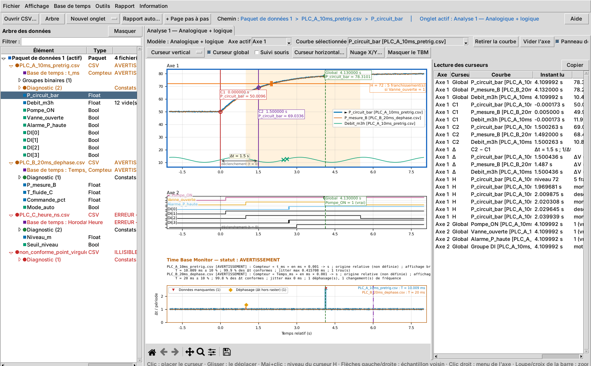

# VISU PTBG 1.0.0 — analyseur graphique de perturbographie

Outil Python d'analyse des fichiers CSV de **perturbographie (PTBG)** produits par les PLC
Framatome TXS Compact (projet NPI-NCS), conforme à la spécification
**NCS/00/I/COMMON----/ES/010 Rev. A** (`docs/specification/`).

Il lit un ou plusieurs CSV (un par PLC), **contrôle la base de temps** de chacun
(période, stabilité, croissance continue, trous, déphasage, changements de fréquence),
l'affiche dans un **Time Base Monitor**, et offre l'analyse graphique des signaux Bool,
Float et groupes binaires : onglets à modèles de disposition, curseurs simple / double /
global / horizontal conditionné / X/Y, traitement conditionnel, rapports **PDF**
automatique et pas à pas.



## 1. Démarrer

| Poste | Démarrage |
|---|---|
| **Windows 11 + Spyder 6** | ouvrir `MAIN.py` puis **F5**. Rien à installer : numpy et matplotlib de Spyder suffisent |
| **SLES 15 SP7** | `sudo zypper install python311 python311-tk python311-pip`, puis `install/installer_sles.sh` (une fois) et `install/lancer_sles.sh` |
| Windows sans Spyder | Python 3.11 64 bits (python.org, avec Tcl/Tk), puis `install\installer_windows.bat` et `install\lancer_windows.bat` |
| Terminal | `python MAIN.py [fichiers.csv ...]` |

Pour essayer : Fichier > Ouvrir un dossier de CSV > `data/demo/` (trois PLC : 10 ms avec
pré-déclenchement, 20 ms déphasé, horodatage hh:mm:ss.ns, et un fichier non conforme).
Les CSV reçus du projet sont dans `data/exemples/`.

## 2. Quelle documentation lire ?

| Je veux… | Document |
|---|---|
| **utiliser l'outil** (aussi dans l'outil : Information > Fichier d'aide, F1) | [docs/GUIDE_UTILISATEUR.md](docs/GUIDE_UTILISATEUR.md) |
| savoir **où en est chaque requis** (réalisation, code, test, statut) | [docs/TRACABILITE_REQUIS.md](docs/TRACABILITE_REQUIS.md) |
| la même chose en **tableur**, avec les **questions ouvertes** à faire valider | [docs/recapitulatif/Recapitulatif_requis_VISU_PTBG.xlsx](docs/recapitulatif/Recapitulatif_requis_VISU_PTBG.xlsx) (onglet « Points ouverts ») |
| **installer ou qualifier** l'outil sur Windows 11 ou SLES 15 SP7 | [docs/COMPATIBILITE_OS.md](docs/COMPATIBILITE_OS.md) |
| connaître les **bibliothèques**, leurs licences, l'impact d'une **montée de version** | [docs/DEPENDANCES.md](docs/DEPENDANCES.md) |
| **reprendre ou modifier le code** | [docs/ARCHITECTURE.md](docs/ARCHITECTURE.md) |
| voir **ce qui a changé** d'une version à l'autre | [CHANGELOG.md](CHANGELOG.md) |
| voir un **exemple de rapport** PDF | [docs/exemples/rapport_exemple_demo.pdf](docs/exemples/rapport_exemple_demo.pdf) |
| voir des **captures** | [nuage X/Y](docs/captures/02_nuage_xy.png), [diagnostic](docs/captures/03_diagnostic.png), [base de temps](docs/captures/04_configuration_base_de_temps.png), [axe absolu passant minuit](docs/captures/05_axe_absolu_minuit.png) |

## 3. Organisation du dossier

| Dossier | Contenu |
|---|---|
| `MAIN.py` | construit l'interface, rien d'autre (REQ 3002) |
| `ptbg/core/` | traitements sans interface : CSV, base de temps, curseurs, X/Y… |
| `ptbg/plotting/` | dessin commun écran et PDF, Time Base Monitor |
| `ptbg/report/` | rapport PDF |
| `ptbg/gui/` | interface Tkinter : contrôleur, arbre, onglets, dialogues |
| `ptbg/system/` | compatibilité Windows / SLES, environnement, journal |
| `tests/` | 145 tests automatisés (dont l'interface réelle et la robustesse) |
| `tools/` | audit d'environnement, banc de performance, traçabilité, données de démo |
| `install/` | installation et lancement Windows / SLES |
| `data/demo/` | CSV de démonstration (3 PLC + 1 fichier non conforme) |
| `data/exemples/` | CSV reçus du projet (inchangés) |
| `data/references_simulation/` | scripts de simulation de référence reçus (inchangés, hors outil) |
| `docs/` | documents ci-dessus, spécification (Word), récapitulatif Excel, captures, rapport exemple |

## 4. État des requis

Les 64 lignes de la spécification sont tracées dans
[docs/TRACABILITE_REQUIS.md](docs/TRACABILITE_REQUIS.md) et dans le récapitulatif Excel.

| Statut | Lignes |
|---|---|
| Implémenté et testé | 47 |
| Implémenté selon une interprétation à valider (questions dans l'Excel, onglet « Points ouverts ») | 14 |
| Proposition (énoncé vide dans la Rev. A) | 1 |
| Implémenté, qualification sur cible ou sur volumes réels à faire | 2 |
| **Total** | **64** |

## 5. Dépendances, robustesse, performances

| Sujet | En bref | Détail |
|---|---|---|
| Dépendances | Python **3.11** (référence ; vérifié de 3.10 à 3.14), Tkinter, **numpy** et **matplotlib**, rien d'autre ; versions figées dans `requirements.txt`, identiques Windows et SLES | [DEPENDANCES.md](docs/DEPENDANCES.md), [COMPATIBILITE_OS.md](docs/COMPATIBILITE_OS.md) |
| Robustesse | un fichier abîmé (ligne tronquée ou en trop, guillemet non fermé, octets nuls, en-tête absent ou répété, encodage non UTF-8, horodatage aberrant…) est lu sans exception, sans perte silencieuse ni valeur inventée ; chaque anomalie est citée avec sa ligne | guide § 2 ; `tests/test_robustesse.py` |
| Performances (banc Linux, Python 3.11) | 1 million de lignes × 21 colonnes (115 à 157 Mo) lues et analysées en 5 à 7 s, en arrière-plan ; curseurs fluides (moins de 30 ms par mouvement) sur des courbes d'un million de points | [TRACABILITE_REQUIS.md](docs/TRACABILITE_REQUIS.md), dernière section |

## 6. Vérifier

```
python -m unittest discover -s tests -v     # 145 tests (sous Linux sans bureau : xvfb-run devant)
python tools/verifier_tracabilite.py        # chaque requis du Word : matrice + code + test
python tools/audit_environnement.py         # versions présentes / versions figées
python tools/banc_performance.py f.csv      # durées et mémoire (ou --generer 500 : fichier de 500 Mo)
```

Les tests d'interface ouvrent de vraies fenêtres ; ils sont ignorés sans écran.
